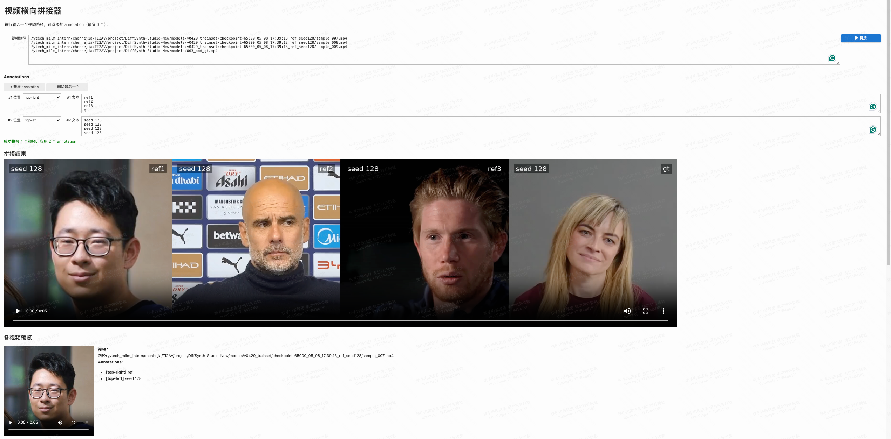

# LiveViewer

基于 Jupyter + Voila 的视频横向拼接与预览工具。输入多个本地视频路径，可在每路视频上叠加文字 annotation，使用 ffmpeg 拼接成一段视频，并同时展示各路原视频预览。



## 功能

- 多视频横向拼接（`hstack`）+ 音频混流（`amerge`）
- 每路视频可叠加多条 annotation 文本，支持 6 种位置：`top / bottom / top-left / top-right / bottom-left / bottom-right`
- Annotation 行动态增删，最多 6 行；每行文本按行对应各路视频（第 N 行对应第 N 个视频）
- 拼接结果视频与各路视频预览在同一页面展示
- 仅支持 `.mp4` 视频

## 环境依赖

- Python 3.10（conda 环境 `viewer`）
- 系统已安装 `ffmpeg`
- Python 包：`voila`、`ipywidgets`、`ipykernel`

### 安装

```bash
conda activate viewer
pip install voila ipywidgets ipykernel

# 在 viewer 环境下注册 Jupyter 内核（首次使用必须）
python -m ipykernel install --user --name viewer --display-name "Python (viewer)"
```

## 运行

```bash
conda activate viewer
voila /ytech_milm_intern/chenhejia/projects/LiveViewer/video_player.ipynb \
    --port=8890 --Voila.ip='0.0.0.0' --no-browser
```


在 KML 界面中使用与 Jupyter 一致的方式打开前端。注意和设置的端口一致。

## 使用步骤

1. 在「视频路径」文本框中每行粘贴一个视频的绝对路径。
2. （可选）点击 `+ 新增 annotation` 添加一行 annotation：
   - 左侧 dropdown 选择文字位置。
   - 右侧文本框按行写入：第 1 行对应第 1 个视频，第 2 行对应第 2 个视频……留空则该视频此条 annotation 不显示。
3. 点击「拼接」按钮，等待 ffmpeg 处理。
4. 页面下方依次显示：状态信息、拼接结果视频、各视频预览（含 annotation 清单）。

### Annotation 转义命令

文本中可插入以下占位符，渲染到对应视频时展开：

| 命令 | 含义 | 说明 |
| --- | --- | --- |
| `/frame_idx` | 当前帧编号 | 动态值，随视频播放变化 |
| `/name` | 当前视频的文件名 | 例如 `demo.mp4`，按所属视频分别替换 |

示例：
```
frame: /frame_idx  (/name)
```

## 已知事项

- 视频通过 base64 内嵌到 `<video>` 标签播放，适合中小文件；超大视频会占用较多内存/带宽。
- 输入视频可有可无音频流：有则混流（`amerge`），全部无则输出无音轨。
- 拼接输出写入 `/tmp`，由系统自行清理。
